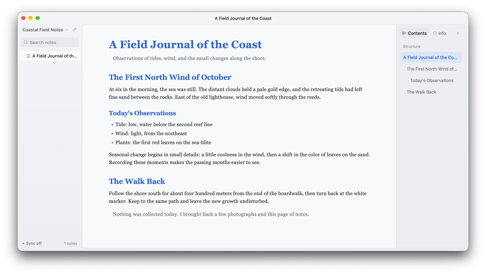

# StoatMD

A Markdown notebook for people and AI agents. StoatMD keeps notes as ordinary Markdown files in a folder you control, with optional Google Drive or Dropbox sync.

**Desktop is free. The official iOS app is a one-time purchase on the App Store.** The source is available for personal, noncommercial use; you can build and sign your own copy.

[Website](https://stoatmd.com) · [Releases](https://github.com/richcalls/stoatmd/releases) · [Issues](https://github.com/richcalls/stoatmd/issues) · [简体中文](README.zh-CN.md)



## Features

- Write plain Markdown files that you can open with other editors and local or remote AI agents.
- Switch between source editing, split view, and a focused reading view.
- Search notes, browse a collapsible folder tree, and manage files from the app.
- Sync through your own Google Drive or Dropbox account, with offline caching and conflict handling.
- Choose from 20 themes, adjust typography, and use the interface in eight languages.
- On iPhone and iPad, connect a cloud folder and continue working offline with a local cache.

## Availability

| Platform | Availability |
| --- | --- |
| macOS | Free; local folders and cloud sync. Tagged releases include an ad-hoc signed CI ZIP; maintainers may also publish a notarized installer. |
| iOS / iPadOS | Official app sold as a one-time App Store purchase; personal builds are supported |
| Windows / Linux | Free desktop packages are built automatically for tagged releases |

## Build from source

Requirements: Rust stable, Python 3, and [nsh CLI 0.5.0](https://nsh.dev). Full Xcode is required for iOS simulator and device builds.

```sh
git clone https://github.com/richcalls/stoatmd.git
cd stoatmd
curl -fsSL https://nsh.dev/install.sh | NSH_VERSION=v0.5.0 sh
nsh check
nsh test
nsh run --target macos
```

For Google Drive or Dropbox, configure your own OAuth client. For personal iPhone installation, use your own Apple Development certificate, provisioning profile, and app identifiers. See the [build guide](docs/BUILDING.md) for setup and platform-specific commands.

## License

StoatMD source is available under the [PolyForm Noncommercial 1.0.0 License](LICENSE). Personal use, study, modification, and sharing for noncommercial purposes are permitted under its terms. Commercial use, selling copies, and paid distribution require separate permission from the rights holder. This is a source-available, noncommercial project.

Third-party components and assets retain their own terms; see [Third-Party Notices](THIRD_PARTY_NOTICES.md).

## Contributing and security

Read the [contribution guide](CONTRIBUTING.md) before opening a pull request. Report security issues through the private process in [SECURITY.md](SECURITY.md).

## Project docs

- [Build and personal iOS installation](docs/BUILDING.md)
- [Product overview](docs/product/PRODUCT.md) · [Sync design](docs/product/SYNC.md) · [Maintainer release guide](docs/product/RELEASE.md)
- [Website development](website/README.md)
