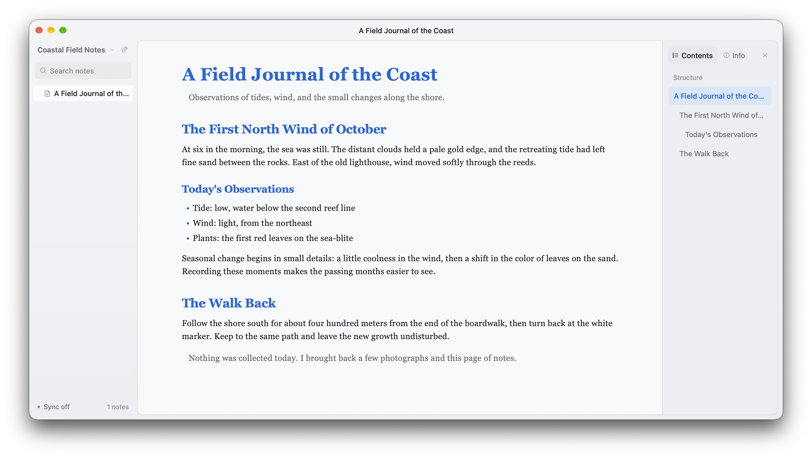

# StoatMD

一款供用户与 AI Agent 共同使用的 Markdown 笔记本。笔记以普通 Markdown 文件保存在你自己的文件夹中，也可以选择使用 Google Drive 或 Dropbox 同步。

**桌面版免费；iOS 官方版在 App Store 一次买断。** 源码采用非商业授权，个人可以自行编译、签名和使用。

[官方网站](https://stoatmd.com) · [下载与版本](https://github.com/richcalls/stoatmd/releases) · [问题反馈](https://github.com/richcalls/stoatmd/issues) · [English](README.md)



## 功能

- 使用普通 Markdown 文件，兼容其他编辑器，也方便本地或远程 AI Agent 读写。
- 在源码编辑、分栏和专注阅读模式间切换。
- 搜索笔记、浏览可折叠文件树，并在应用内管理文件。
- 通过自己的 Google Drive 或 Dropbox 账号同步，支持离线缓存和冲突处理。
- 提供 20 套主题、排版设置和 8 种界面语言。
- iPhone 和 iPad 通过云盘文件夹同步，并使用本地缓存支持离线工作。

## 平台状态

| 平台 | 发行方式 |
| --- | --- |
| macOS | 免费，支持本地文件夹和云盘同步；tag 发布包含 ad hoc 签名的 CI ZIP，维护者也可发布公证安装包 |
| iOS / iPadOS | 官方版在 App Store 一次买断；支持个人自行编译 |
| Windows / Linux | 发布新版本时自动构建免费桌面安装包 |

## 从源码构建

需要 Rust stable、Python 3 和 [nsh CLI 0.3.0](https://nsh.dev)。运行 iOS 模拟器和构建真机版本需要完整 Xcode。

```sh
git clone https://github.com/richcalls/stoatmd.git
cd stoatmd
curl -fsSL https://nsh.dev/install.sh | NSH_VERSION=v0.3.0 sh
nsh check
nsh test
nsh run --target macos
```

连接 Google Drive 或 Dropbox 时，请配置自己的 OAuth 客户端。安装到个人 iPhone 时，请使用自己的 Apple Development 证书、描述文件和应用标识。环境配置与各平台命令见[构建指南](docs/BUILDING.md)。

## 许可

StoatMD 源码采用 [PolyForm Noncommercial 1.0.0](LICENSE) 授权。你可以依照许可条款个人使用、学习、修改和非商业分享。商业使用、售卖副本或收费发行需要权利人另行授权。本项目属于源码公开、非商业授权项目。

第三方组件与素材遵循各自的许可，详见[第三方许可说明](THIRD_PARTY_NOTICES.md)。

## 贡献与安全

提交 Pull Request 前请阅读[贡献指南](CONTRIBUTING.md)。安全问题请通过 [SECURITY.md](SECURITY.md) 中的私密渠道报告。

## 项目文档

- [构建与个人 iOS 安装](docs/BUILDING.md)
- [产品概览](docs/product/PRODUCT.md) · [同步设计](docs/product/SYNC.md) · [维护者发布指南](docs/product/RELEASE.md)
- [官网开发](website/README.md)
