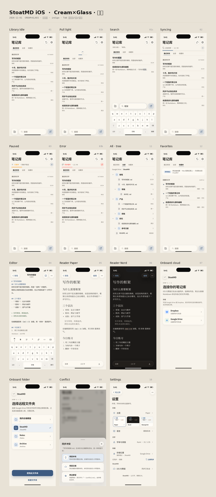

# StoatMD · iOS v1 高保真定稿

2026-11-01 · **Cream×Glass** 高保真 PNG 套 · 交给开发经理按此实现 iOS。

> 本目录以本轮高保真 PNG 为**当前唯一设计真相源**。  
> 旧四屏交互评审板（`index.html` / `design.js` 等）已移至 [`archive-interactive/`](archive-interactive/)，勿再当定稿。



---

## 产品约束（正海已确认）

| 项 | 定稿 |
|----|------|
| 存储 | **仅云盘**：一期 Google Drive / Dropbox。**无独立本地库**、无「打开本机文件夹」、**无本地迁移**、不做 iCloud |
| 真相源 | 云盘是真相源；本地可缓存以便离线浏览/编辑（缓存 ≠ 本地库模式） |
| 首启 | 选云盘 → 选远程文件夹 → 进库（**无迁移步**） |
| 切换存储 | 仅云盘 ↔ 云盘（换提供商或远程文件夹） |
| 风格参考 | 参考妙言笔记气质，**不照抄**像素 / Tab IA / 森绿 / iCloud 叙事 |

Mac 侧仍保留本地免费 + 云盘买断与本地↔云盘迁移；iOS 边界与此不同。同步细则见 [`../product/SYNC.md`](../product/SYNC.md)。

---

## 视觉定稿 · Cream×Glass

| Token | 值 | 用途 |
|-------|-----|------|
| 主底 | `#F7F3EB` 纯色奶油纸 | **禁止页面渐变**；暗色/Nord 用对应纯色 `--paper` / `--sys-bg` |
| Chrome | Liquid Glass | 顶栏、底栏、搜索、同步条、格式条、sheet、设置返回 |
| 强调色 | `#3D5A80` 靛蓝 | CTA、进度条、选中；进度条用实色，不要 soft gradient |
| 正文 | 对齐 Mac **Kami** | 衬线（Songti / Noto Serif CJK）、字重 500、行高约 1.55、tracking 0.3pt；引用**无底无侧线**；行内 code 暖灰底 |
| 字号比（手机略缩） | H1/H2/H3/正文 ≈ 31/23/19/15 | 与 Mac 预览/编辑一致 |

反 AI-slop：纸面世界、大字层级；列表用 hairline / 轻玻璃，不做厚白大卡片；顶栏右「同步」「设置」为独立圆形 glass，不挤脏 pill。

---

## 库页信息架构

### 顶 Tab（三选一 · 文字 + 下划线，无厚黑胶囊）

1. **最近修改**（**默认**）— 最近改过的文件列表；无文件夹分区  
2. **全部** — 可嵌套**文件树**（见 `11-file-tree`）；路径示意如 `Google Drive / StoatMD`  
3. **收藏夹** — **未来功能**（Mac 未做）；稿含「即将推出」示例（见 `12-favorites`），Cream×Glass，非灰禁用

### 底栏（真机 Grok Bot 式 · 分离浮起 Liquid Glass）

三件**分开**悬浮于 home indicator 上方，左右有边距，**不贴底实色连体条**：

| 位置 | 控件 |
|------|------|
| 左 | 独立圆角方玻璃钮 = **新建文件夹** |
| 中 | 超宽玻璃搜索胶囊（🔍 +「搜索」） |
| 右 | 同高玻璃圆钮 = **新建文件** |

- `01c` = 搜索激活态  
- `01b` = 下拉浅度刷新态（见下）

### 同步两条路径

| 手势 / 入口 | 行为 | 稿 |
|-------------|------|----|
| **下拉** | **浅度刷新**（少量文件改动）：**无提示文案**，只出现刷新指示 + 进度 | `01b` |
| **右上同步按钮** | **完整同步**（首次 / 大量文件）：顶下细进度 accessory；可**暂停 / 继续**，失败可**重试** | `02` syncing · `03` paused · `03b` error |

同步状态机**仅出现在库页**（idle / syncing / paused / error）。

---

## 其它屏约定

| 屏 | 要点 |
|----|------|
| 编辑 `04` | 安静玻璃顶栏；顶右**书本图标**切阅读；「已保存」为标题下小字；**无**「编辑\|阅读」分段控件；扁平格式条 |
| 阅读 `05`/`06` | 顶右文字「编辑」；安静玻璃底栏：目录 / 字数 / A；正文 Kami；Paper / Nord |
| 首启 `07`/`08` | 仅 Drive/Dropbox → 选远程文件夹；无迁移、无本地库选项 |
| 冲突 `09` | Sheet 三选一：保留本地 / 保留云端 / 两边都留 |
| 设置 `10` | 主题缩略、语言、存储（仅两家云盘） |

---

## PNG 索引

### 拼板

| 文件 | 内容 |
|------|------|
| [`00-board-overview.png`](00-board-overview.png) | 全套拼板（含文件树 + 收藏夹） |
| [`00-board-library.png`](00-board-library.png) | 库相关拼板 |

### 库态

| 文件 | 内容 |
|------|------|
| [`01-library-idle.png`](01-library-idle.png) | 库 · 空闲 · 浅色 ·「最近修改」默认 |
| [`01-library-idle-dark.png`](01-library-idle-dark.png) | 库 · 空闲 · 暗色 |
| [`01b-library-search-pulled.png`](01b-library-search-pulled.png) | 下拉浅度刷新（指示 + 进度，无文案） |
| [`01c-library-search-active.png`](01c-library-search-active.png) | 底栏搜索激活 |
| [`02-library-syncing.png`](02-library-syncing.png) | 完整同步进行中（可暂停） |
| [`03-library-paused.png`](03-library-paused.png) | 完整同步已暂停（可继续） |
| [`03b-library-error.png`](03b-library-error.png) | 完整同步失败（可重试） |
| [`11-file-tree.png`](11-file-tree.png) | 「全部」Tab · 可嵌套文件树 |
| [`12-favorites.png`](12-favorites.png) | 「收藏夹」Tab · 即将推出示例 |

### 编辑 / 阅读

| 文件 | 内容 |
|------|------|
| [`04-editor.png`](04-editor.png) | 源码编辑 · Kami 对齐 · 已保存小字 |
| [`05-reader-paper.png`](05-reader-paper.png) | 阅读 · Paper |
| [`06-reader-nord.png`](06-reader-nord.png) | 阅读 · Nord / 暗 |

### 首启 / 冲突 / 设置

| 文件 | 内容 |
|------|------|
| [`07-onboarding-provider.png`](07-onboarding-provider.png) | 首启 · 选 Drive / Dropbox |
| [`08-onboarding-folder.png`](08-onboarding-folder.png) | 首启 · 选远程文件夹 |
| [`09-conflict-sheet.png`](09-conflict-sheet.png) | 冲突三选一 sheet |
| [`10-settings.png`](10-settings.png) | 设置 |

### 生成辅助贴图（非屏稿）

| 文件 | 说明 |
|------|------|
| `thread.png` / `thread-dark.png` | 织线等辅助贴图，供 HTML 源截图使用 |

同名 `.html` 为对应屏 HTML 源，可本地打开对照。

---

## 源与再生

| 路径 | 说明 |
|------|------|
| `NOTES.md` | 本轮打磨过程与中间决策记录（以本文定稿为准；NOTES 含迭代纠偏） |
| `liquid.css` · `screens.css` | Cream×Glass / 屏样式 |
| `gen_liquid_library.py` | 生成库相关 HTML |
| `gen_liquid_rest.py` | 生成 04–12 等其余屏 |
| `capture_liquid.py` · `capture_rest.py` · `capture.py` · `capture.mjs` | Playwright 截图脚本 |
| `package.json` / `package-lock.json` | 截图依赖声明（**勿提交 `node_modules`**） |
| `liquid/` | 预留目录（当前可空） |
| `archive-interactive/` | 旧交互评审板与早期模拟器图；见该目录说明 |

本地预览 HTML（需自备静态服务）：

```sh
cd docs/ios-v1
python3 -m http.server 4173 --bind 127.0.0.1
# 打开 http://127.0.0.1:4173/01-library-idle.html 等
```

---

## 工程实现指针

- 代码：`src/mobile/`；复用 Rust Vault、同步引擎、Kami 排版。  
- 运行 / OAuth / TestFlight 等工程说明见归档 [`archive-interactive/README-legacy.md`](archive-interactive/README-legacy.md)（产品「仅云盘」约束与本文一致；**UI 以本目录 PNG 为准**，勿按旧交互板实现）。  
- 实现验收以本 README 定稿 + 上表 PNG 为准。
