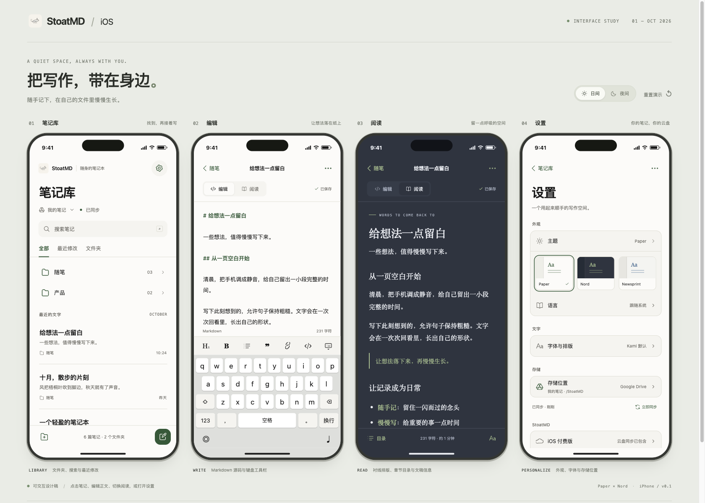
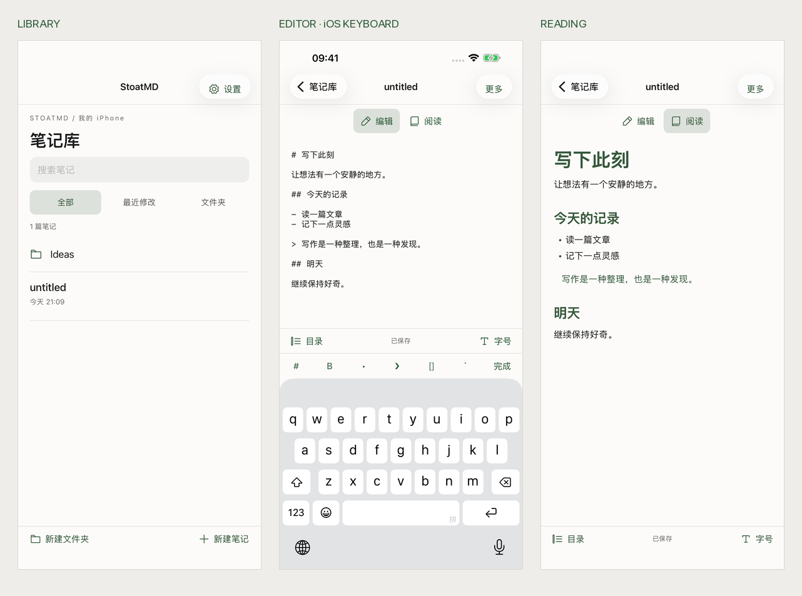

# StoatMD · iOS v0.1

2026-10-31 · 核心功能优先，界面继续迭代。

[打开交互设计稿](index.html) · [查看总览图](overview.png)



## 产品规则

iOS 是付费应用，售价包含 Google Drive / Dropbox 同步。首次启动连接账号、选择远程文件夹并下载笔记库；设备中的文件作为当前云盘的离线缓存，支持离线编辑和联网同步。存储设置提供两家云盘，独立本地库、iCloud 和额外 Pro 购买入口均已移除。

macOS 保留本地免费、云盘买断的规则。一个笔记库同一时间绑定一个存储位置，切换时复制和校验文件，默认保留原位置数据。详见 [同步与迁移](../product/SYNC.md)。

## 已接入的核心功能

- 云盘入口、系统 OAuth PKCE、系统钥匙串、远程目录选择与创建、存储迁移、离线缓存和同步冲突处理。
- 文件夹导航、标题与正文搜索、新建笔记与文件夹、重命名、创建副本、移动、回收站、恢复和永久删除。
- Markdown 源码输入、系统键盘与格式工具、阅读预览、章节目录、25 套主题、8 种语言、独立编辑与阅读字号。
- 系统文件导入导出：导入 UTF-8 Markdown / 文本，单文件上限 5 MB；导出当前 Markdown 副本。
- 输入后立即排队保存，合并连续写入；原子替换 Markdown，保存成功后更新状态。持久草稿支持失败重试、重启恢复和冲突保留副本。

代码位于 `src/mobile/`，复用 Rust Vault、同步引擎、全文搜索、Markdown 解析和 Kami 阅读排版。iOS 缓存使用应用数据目录下的 `com.stoatmd.app/libraries/<id>`；重新启动时解析当前容器路径。

云盘与系统文件桥接已通过原生编译，真实账号授权和双向同步仍需端到端验收。系统文件选择器已验证弹出，实际选择文件及导出到 Files 的完整往返仍待验收。

## 开发运行与复用 Mac 配置

需要 macOS、完整 Xcode、iOS Simulator、nsh 0.3.0 和 Rust iOS target：

```sh
rustup target add aarch64-apple-ios-sim
python3 scripts/ios.py run
```

`scripts/ios.py` 从现有 Mac `~/Library/Application Support/StoatMD/sync.json` 读取公共 OAuth 标识并传入构建。支持 `STOATMD_CONFIG_PATH` 和 `STOATMD_SUPPORT_DIR`，显式导出的标识优先。脚本在存在工作区独立 Rust 工具链时自动使用该工具链。

- Dropbox：复用 `dropboxAppKey`。在同一 Dropbox 应用中登记 `db-<AppKey>://oauth2redirect`，启用 `account_info.read`、`files.metadata.read/write`、`files.content.read/write`。
- Google：在现有 Google Cloud 项目增加「iOS」OAuth 客户端，绑定正式 Bundle ID `com.stoatmd.app`，启用 Drive API。把客户端 ID 存为 `googleIosClientId`，或导出 `STOATMD_GOOGLE_IOS_CLIENT_ID`。
- iOS 使用 PKCE 公共客户端；桌面客户端 secret 留在 Mac 配置中。iOS 原生加载会清空 secret。

发布脚本自动登记 `CFBundleURLTypes`，Google scheme 为 `com.googleusercontent.apps.<客户端 ID 去掉 .apps.googleusercontent.com>`，Dropbox scheme 为 `db-<AppKey>`。回调分别为 `<Google scheme>:/oauthredirect` 和 `<Dropbox scheme>://oauth2redirect`。开发宿主 Bundle ID 为 `com.longbridge.nsh.host`，Google 调试客户端需匹配宿主标识。

可指定模拟器和原生回归：

```sh
python3 scripts/ios.py run --device "iPhone 17 Pro Max"
python3 scripts/ios.py test src/mobile/MobileShell.test.tsx
```

## TestFlight 打包

使用已安装的 Apple Distribution 证书与匹配 `com.stoatmd.app` 的 App Store 描述文件：

```sh
rustup target add aarch64-apple-ios
python3 scripts/ios_release.py \
  --identity "Apple Distribution: YOUR NAME (TEAM_ID)" \
  --profile /absolute/path/StoatMD-AppStore.mobileprovision \
  --build 1
asc builds upload --app 6829230372 --ipa .nsh/testflight/StoatMD.ipa
```

脚本要求 Google iOS Client ID 与 Dropbox App Key 均已配置，缺少任一项会在编译前报错。脚本复用上述公共 OAuth 配置，打包真机程序，编译无透明通道的 AppIcon 资源，加入回调 scheme、标准加密出口声明与 `PrivacyInfo.xcprivacy`，嵌入描述文件后逐层签名并校验，输出 `.nsh/testflight/StoatMD.ipa`。每次上传递增 `--build`；证书、描述文件和安装包保留在忽略目录。

发布构建默认最低支持 iOS 16；`IPHONEOS_DEPLOYMENT_TARGET` 同时用于 Rust、C 依赖与安装包元数据，确保部署版本一致。

隐私清单声明应用容器和用户所选文件的元数据访问（`C617.1`、`3B52.1`），以及计时用途（`35F9.1`）。笔记由用户授权同步到自己的云盘。正式 App Store 上架的隐私问卷与定价仍需单独设置。

## 验证状态

- `nsh check` 和 `cargo check --target aarch64-apple-ios-sim` 通过。
- Rust 核心测试 19 项通过；应用回归 187 项通过，覆盖云盘首屏和旧本地记录限制、自动保存、草稿恢复、冲突、文件操作与桌面既有功能。
- iPhone 17 Pro Max / iOS 26.2 原生界面回归 3 项通过：中文编辑与搜索、阅读目录、重命名与副本；主题 / 语言 / 字号的重启恢复；移动、回收、恢复与永久删除。
- 原生桥接已验证中文 Markdown 写入及重启读回，系统键盘和 Markdown 格式工具实际运行。
- 复用 Mac Dropbox 公共配置的原生授权检查通过：启动系统授权、主动取消、立即重开再取消。重开会等待前台场景与系统授权可用状态。
- 真实云盘账号首次连接、token 续期、断网重连、双向同步和切换云盘列入下一轮联调。真机输入法、后台切换、辅助功能、大字号和大型笔记库性能仍待验收。



`implementation.png` 展示核心编辑 / 阅读控件的早期模拟器运行效果。正式启动流程以当前云盘首屏为准。


## 设计稿说明

四屏依次展示笔记库、源码编辑、Nord 阅读与设置。默认使用 Paper 和 Nord；顶部可切换整组浅深色，设置可切换单屏主题。「重置演示」恢复示例。

设计稿支持搜索、文件夹、新建与重命名、源码编辑、阅读目录、字号、示例 Markdown 导出，以及云盘授权示意 → 远程目录 → 迁移 → 切换完成。文件、账号和迁移使用内存示例；正式实现状态以验证清单为准。

- `index.html`：四屏评审板。
- `design.css`：响应式评审板与设备样式。
- `design.js`：示例数据、交互与 Markdown 展示。
- `overview.png`：更新后的四屏总览。

在仓库根目录启动本地服务：

```sh
python3 -m http.server 4173 --bind 127.0.0.1
```

访问 `http://127.0.0.1:4173/docs/ios-v1/`。浏览器已验证两家云盘选择和演示迁移。下一轮以真实 Dropbox 账号连接、离线写入和联网读回作为核心验收路径。
