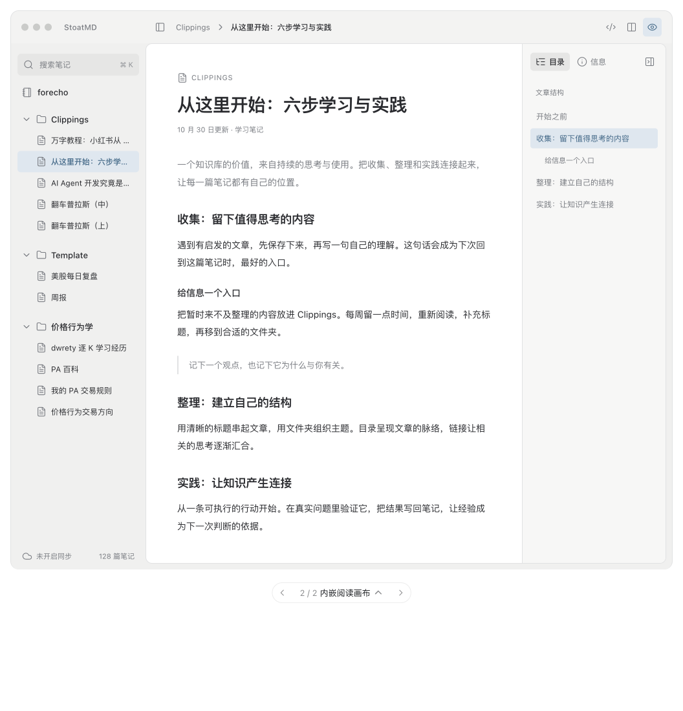

# StoatMD · 内嵌阅读画布

2026-10-30，forecho 认可交互设计稿并要求提交，交由 Qoder 实现。当前选中的方案为「内嵌阅读画布」。本目录交付布局设计与实现说明。

## 查看设计

- [独立交互设计稿](layout.html)：下载后用浏览器打开，支持右栏展开/收起、目录/信息切换、源码/分栏/阅读切换、左栏折叠和搜索。
- [可编辑设计源稿](layout.fragment.html)：独立设计稿的布局、样式与交互源代码。
- [浅色 · 目录展开参考图](inset-outline-light.png)。

设计稿中的文章、时间、标签和统计值均为示例。目录点击用于标记当前章节；正式实现需接入真实滚动定位。源码模式为静态示例，正式编辑继续使用现有原生编辑器。

## 窗口结构

以 [Otty](https://otty.sh/) 的通高侧栏、紧凑顶栏和内嵌内容区为布局参考。

1. 顶部统一为一层约 50–52px 的窗口栏。左侧容纳系统红绿灯与应用名，正文区域顶部容纳文件树开关、当前位置/笔记标题，以及右侧三个模式按钮。
2. 左栏从顶栏下面贯穿窗口，包含搜索、库名、可折叠文件树、同步状态。笔记直接位于所属文件夹下。沿用现有新建笔记、新建文件夹、库操作及右键菜单入口。
3. 工作区嵌入窗口底色，距离右边缘、底边约 9px，圆角约 10px，边界为 1px 主题分隔色。左边与文件树之间以画布边缘形成层次。
4. 正文随可用空间居中。右栏展开后参与横向布局，正文重新计算宽度，长图按正文宽度约束。左右侧栏与正文分别滚动。

| 尺寸 | 设计参考 |
| --- | --- |
| 左文件树 | 208px；适配现有内容时可在 180–240px 调整 |
| 右文章栏 | 222px；约 200–240px |
| 正文最大宽度 | 设计稿 650px；正式排版结合现有 Kami 测宽与字体设置适配 |
| 正文左右留白 | 宽窗口约 48px，空间收紧时约 24–28px |
| 图标按钮 | 可见区域约 28–29px，命中区域与无障碍能力沿用原生控件 |

尺寸单位在 nsh 中按逻辑尺寸映射。系统红绿灯、窗口拖动和最小尺寸由原生窗口能力承载。

## 顶部按钮与设置

右侧常驻按钮精简为三个，顺序为源码、分栏、阅读，沿用现有 `edit / split / preview` 模式、选中态和快捷键 ⌘1–3。

字体与设置功能统一从应用菜单「设置…」和 ⌘, 进入。现有设置面板继续提供外观、字体、语言、同步等功能。文件树开关位于顶栏正文区域左侧，并保留 ⌘B。

## 右侧文章栏

- 每次启动默认收起，收起时正文画布右缘保留小型「目录」标签，点击展开。默认展示「目录」页签。
- 展开后顶部显示「目录」「信息」两个页签，以及收起按钮。收起后恢复正文可用宽度；同一会话中重新展开可保留上次页签。
- 右栏在三种编辑模式下均可打开。空库、无打开文章时入口隐藏；删除或关闭当前文章时清空关联数据。
- 窄窗口优先保证正文最小可读宽度，可让右栏覆盖在画布右侧，并通过关闭按钮或 Escape 收起。设计稿的窄屏上下排列用于浏览器查看；本轮产品实现重点为 macOS。

### 目录

从当前文章解析 H1–H6，按层级缩进，使用稳定的块索引或标识区分同名标题。标题来自 Markdown 解析结果，代码块里的 `#` 保持为代码内容。省略的标题可通过 tooltip 查看全文。

点击目录定位对应章节；源码模式定位源码行，阅读模式定位预览块，分栏模式沿用现有双向滚动同步。随正文滚动更新当前章节高亮。编辑标题后更新目录。无标题文章展示简洁空态。

### 信息

展示当前文章的字符数、预计阅读时间、段落数、标题数，以及文件创建时间、修改时间、格式、相对路径；标签随真实文档元数据提供。未知时间使用本地化占位，实际值从文件元数据读取。

统计口径在实现中明确，并使用同一正文快照更新：字符数按 Unicode 字符计数；阅读时间采用明确的中英文估算规则；段落和标题数来自解析树。长文统计与目录计算复用预览解析或节流更新，以保持输入和滚动流畅。

## 视觉与现有规范衔接

本目录作为新的 macOS 窗口布局依据，优先应用本稿的内嵌画布、统一顶栏、三个模式按钮和可收起右栏。`docs/ui-v1/` 保留其他现有产品约定。

设计稿以中性浅深色展示结构；实现时映射现有 `theme.ts`、`theme.json` 和主题 token，兼容全部主题。用户字体、字号、行高设置与现有 Kami 默认排版继续生效；图片、表格、代码块随画布宽度适配。

## Qoder 实现入口

| 当前文件 | 实现关注点 |
| --- | --- |
| `src/ui/MacShell.tsx` | 窗口层级、当前文章数据、左右栏状态、菜单与设置入口 |
| `src/ui/Toolbar.tsx` | 整合 TitleBar / WorkspaceToolbar，顶部模式按钮与文件树开关 |
| `src/ui/ModeSwitch.tsx` | 复用三个模式及当前选中状态 |
| `src/ui/Sidebar.tsx` | 文件树全高布局，保持搜索、新建、同步与右键操作 |
| `src/ui/EditorWorkspace.tsx` | 内嵌画布、正文宽度、目录滚动定位、三种模式布局 |
| `src/ui/previewModel.ts`、`src/ui/scrollSync.ts` | 标题解析、预览块映射、滚动位置与同步 |
| `src/ui/SettingsSheet.tsx`、`src/ui/theme.ts`、`src/ui/typography.ts` | 设置可达性、现有主题与字体偏好 |
| `locales/*.json` | 补齐目录、信息、统计和空态等文案，覆盖现有语言 |

可新增独立的文章检查栏与目录/统计模型，拆分布局、数据解析、文件元数据读取。按 nsh 原生 TSX 组件实现设计。

## 验收要点

- 启动时右栏收起，顶栏右侧为三个模式按钮；从菜单和 ⌘, 可进入设置。
- 宽窗口、最小窗口、左右栏分别折叠、三种编辑模式均布局完整；正文、长图、表格与代码块适配可用宽度。
- 目录点击可定位，滚动高亮与当前章节一致；覆盖中文、emoji、重复标题、Setext 标题、嵌套内容与代码围栏。
- 切换/删除笔记后目录、统计和元数据及时更新；无文章、无标题、空文件均有合理状态。
- 保存、外部修改冲突、同步、新建、搜索、右键操作与主题/字体切换保持可用，分栏继续满足既有滚动同步要求。
- 新增交互提供键盘与无障碍标签；按既有 harness/test 结构验证模型与控件，并运行 `nsh check`、`nsh test`，最后完成 macOS 窗口实测。
